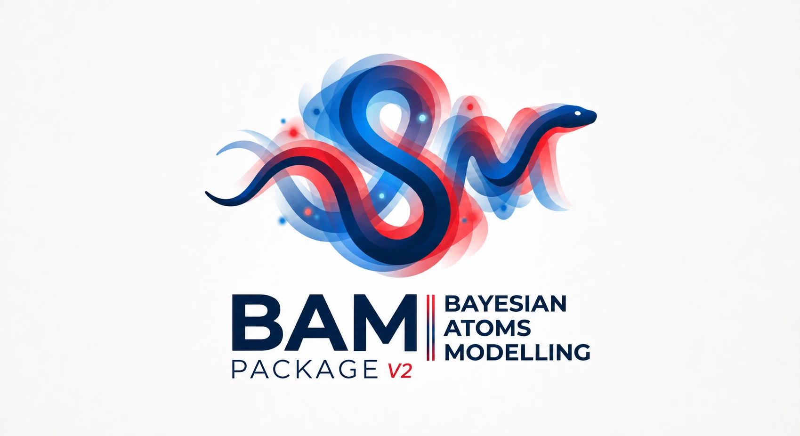

<p align="center"></p>

# RACE v2

> **Branch notice (2026-11-16).** `main` now holds the RACE v2 code in a new layout (python package `race_v2`).
> The previous `main` (BAM_V2 up to April 2026, with `bam_torch`, `bam_torch_cue` and `bam_3bpa`) was moved to the
> [`deprecated`](https://github.com/myung-group/BAM_V2/tree/deprecated) branch. Use that branch if you depend on the
> old code.
>
> **Branch `race-v2.1-final` (2026-11-23).** Code of the RACE v2.1 models (`main` + the v2.1 architecture, training
> and core-exclusion commits). What changed and why: [RACE v2.1](#race-v21-branch-race-v21-final-changes-with-respect-to-race-v20).

## Upgraded: RACE v2.1 (2026-11-23)

RACE v2.1 halves the parameters of RACE v2.0 (17.8M → 9.0M) and improves Matbench Discovery (unique prototypes,
float64, no energy corrections, last epoch of a schedule fixed before the evaluation):

| Model | Params | F1 | MAE (eV/atom) | RMSD (Å) | κ SRME | CPS | CPS rank* | CMDS | CDS |
|---|---|---|---|---|---|---|---|---|---|
| RACE-V2.0-18M-OAM (submitted) | 17.8M | 0.893 | 0.0214 | 0.0643 | 0.229 | 0.858 | 22 | 0.721 | 0.376 |
| RACE-V2.1-9M-OAM | 9.0M | 0.895 | 0.0208 | 0.0637 | 0.177 | 0.870 | 19 | 0.740 | 0.492 |
| **RACE-V2.1-9M-OAM-Replay** | 9.0M | **0.899** | **0.0206** | **0.0632** | **0.162** | **0.875** | **16** | **0.766** | **0.509** |
| change v2.0 → Replay | −49 % | +0.006 | −0.0008 | −0.0011 | −29 % | +0.017 | +6 | +0.045 | +0.133 |

\* among the 63 models with a CPS in the leaderboard data (janosh/matbench-discovery commit 6d587c1). Both v2.0 and
v2.1 use the same schedule (OMat24 2 data epochs, then MPtrj ×8 + sAlex ×1 for 6.2); Replay adds one data epoch with
20 % OMat24 (forces and stress only). CMDS / CDS of v2.1 with core exclusion, of v2.0 without.

**Where the gain comes from.** Of the +0.017 CPS, +0.012 comes with the v2.1 architecture and training changes
(same schedule as v2.0) and +0.005 with the replay stage. The architecture gain is almost entirely in κ (−23 %;
F1 +0.002), and κ depends on the third derivatives of the energy. Our reading, not yet tested by ablation at full
scale:
- the smoothness changes are the most likely main cause: the C4 cutoff envelope (the v2.0 envelope has a jump of the
  third derivative at the cutoff) and the Sobolev-type decay of the high-order radial functions;
- the bilinear layer update is the likely cause of the lower validation force error (MPtrj force MAE 35.7 → 30.4
  meV/Å), since it is the only change that adds expressiveness;
- the tensor-product bottleneck, the low-rank linears and species rank 16 reduce the size; they are not a source of
  the gain, the point is that halving the parameters did not cost accuracy.

A 50k-structure screen gave the opposite sign for κ (0.932 → 1.007), so small screens do not predict this. The planned
check is one full-schedule run with `envelope_q` and `sobolev_decay` off and one with `"update": "linear"`. Details of
every change: [RACE v2.1](#race-v21-branch-race-v21-final-changes-with-respect-to-race-v20).

RACE v2 is an E(3)-equivariant message-passing interatomic potential, an improved version of RACE. The code is written
in JAX (Flax NNX); symmetry operations use e3nn-jax, and the edge tensor product runs on the CUDA kernels of NVIDIA
cuEquivariance. This repository (distribution name `BAM_V2`) holds the model, the training, inference, evaluation and
export code, and the results obtained with it.


## Repository layout

| Folder | What it is | Why it is here |
|---|---|---|
| `race_v2/` | the python package: `models`, `data`, `training`, `inference`, `eval`, `export` | the RACE v2 model and everything that trains and runs it (JAX) |
| `race_v2_torch/` | PyTorch inference port, see its [README](race_v2_torch/README.md) | to use a trained model without JAX: it converts a JAX checkpoint and gives an ASE calculator. Inference only, no training |
| `lammps/` | C++ sources of `pair_style race`, the runtime wrapper, a build script and the third-party headers they need | to run molecular dynamics of large systems in LAMMPS. The model is exported once (`race_v2/export/lammps.py`) and then runs from C++ without Python |
| `scripts/` | launchers and helpers: `train`, `eval` (Matbench Discovery, uncertainty, benchmarks), `data` | the commands that produced the results in `docs/results`, kept so that they can be repeated |
| `configs/` | representative training configs, see [configs/README.md](configs/README.md) | one config per workflow that was actually run (small-data recipe, MPtrj, OMat24 pretraining, fine-tuning, OMol25) |
| `docs/` | the reports under `docs/results/`, the methods summary and the usage documents | results and methods; working notes are not kept on `main` |
| `dataset_3BPA/` | the 3BPA data set (4 small extxyz files) | example data: `configs/base`, `configs/smoke` and the unit tests run on it without any download |
| `tests/` | unit tests | `pytest tests` |
| `bam_omat24/`, `racev2_torch/` | aliases for the old package names | so that old commands, imports and checkpoints keep working (see below) |

Folders of the previous `main` that are not here:

| Folder of the old `main` | What it was | Where it is now |
|---|---|---|
| `bam_torch/` | PyTorch training backend (e3nn) of the first BAM_V2 | [`deprecated`](https://github.com/myung-group/BAM_V2/tree/deprecated) branch only. The PyTorch code on `main` is `race_v2_torch/`, which does inference only |
| `bam_torch_cue/` | PyTorch training backend with cuEquivariance | `deprecated` branch only |
| `bam_3bpa/` | early JAX code for the 3BPA benchmark | `deprecated` branch only; its role is taken by `race_v2/` with `configs/base` |
| `bam_omat24/` (real code) | the JAX backend | renamed to `race_v2/`; the folder of that name on `main` only holds aliases |
| `input/` | old configs | `deprecated` and `racev2` branches; the configs in use are in `configs/` |

### Why are `bam_omat24/` and `racev2_torch/` still here?

Until 2026-11-16 the package was called `bam_omat24` and the PyTorch port `racev2_torch`. Both were renamed
(`race_v2`, `race_v2_torch`), but existing work still uses the old names:
- job scripts and notebooks that run `python -m bam_omat24.train_3bpa`, `import bam_omat24...` or
  `import racev2_torch`;
- checkpoints written before the rename, whose optimiser state is pickled under the module path
  `bam_omat24.soap_grouped`.

The two folders contain no code of their own. Every file in them is a generated alias of about 30 lines that
forwards an old module name to the new module, so old commands, imports and checkpoints keep working. Do not edit
them; new code should import `race_v2` and `race_v2_torch`. They can be deleted once nothing uses the old names
(`race_v2.training.utils.load_checkpoint` reads old checkpoints without them). The table of old and new names, the
commands and the limits of the aliases are in [docs/LAYOUT.md](docs/LAYOUT.md).

## Results

### Universal models

| Model | Benchmark | Result | Details |
|---|---|---|---|
| **RACE v2 OAM** (17.8M parameters; OMat24 2 epochs, then MPtrj ×8 + sAlex ×1) | Matbench Discovery, full WBM, unique prototypes | F1 0.893, MAE 0.0214 eV/atom, R² 0.872, RMSD 0.0643 Å, κ SRME 0.229, CPS 0.858 (about rank 20 of 49 on the leaderboard read on 2026-11-15); DAF 5.947, precision 0.909, accuracy 0.968; outside CPS: molecular dynamics CMDS 0.721, diatomic curves CDS 0.376 | [docs/results/race_v2_oam_mbd](docs/results/race_v2_oam_mbd/README.md), [docs/mbd_md_diatomics.md](docs/mbd_md_diatomics.md) |
| **RACE v2 MPtrj-only** (17.8M) | same | F1 0.777, MAE 0.040, R² 0.800, RMSD 0.0785, κ SRME 0.375, CPS 0.761 (about rank 6 of the 19 MPtrj-only models) | same folder |
| **RACE v2 LR-POLAR** (OMol25 4M) | OMol25 validation sets | see the folder | [docs/results/race_v2_lr_polar_omol25_4m](docs/results/race_v2_lr_polar_omol25_4m/README.md) |

The Matbench Discovery numbers use float64 inference of the float32-trained model (`BAM_PREDICT_X64=1`,
[docs/inference_precision.md](docs/inference_precision.md)), no energy corrections, and the last epoch of a schedule
fixed before the evaluation.

### Small-data benchmarks

Protocol of this section:
- Each model is trained on the training split of its dataset only: no pretraining, no extra data, no augmentation.
- Values are means of 3 seeds. Checkpoints are selected on validation (EMA weights).
- Energies are given after a closed-form refit of one per-atom energy constant on the training split; forces are
  unchanged.
- The test sets were evaluated during training and were seen while the recipe was developed. The 3BPA note below
  states where a choice was made after looking at test errors.

**3BPA** (RMSE, E in meV/molecule / F in meV/Å; trained on 450 frames at 300 K)

| Model | 300 K | 600 K | 1200 K | Dihedral |
|---|---|---|---|---|
| **RACE v2** (UFF-nb, chosen after test, see note) | 1.56 / **6.31** | **6.05 / 15.92** | 22.20 / **45.16** | 16.67 / 19.09 |
| RACE v2 ZBL-nb (rule fixed in advance) | 1.62 / 6.53 | 7.44 / 16.89 | 24.68 / 50.79 | 10.44 / 17.42 |
| RACE V1 (published, single model) | 3.4 / 12.1 | 11.7 / 31.8 | 37.5 / 115.3 | — |
| GRACE/ACE(g) (PRX 2024, 5 fits) | 1.7 / 7.6 | 7.3 / 19.2 | 25.8 / 61.7 | **7.4 / 15.3** |
| PACE (TMLR 2024, 3 seeds) | 2.4 / 9.1 | 7.9 / 21.4 | 29.6 / 60.7 | 7.6 / 16.0 |
| TACE spe-cart ν=3 (1 seed) | 2.69 / 8.68 | 8.10 / 19.88 | 23.42 / 54.26 | 11.0 / 16.45 |
| SpinGTP | 2.9 / 9.0 | 9.6 / 21.0 | 29.0 / 61.4 | 8.9 / **15.3** |
| ICTP_full (5 runs) | 2.70 / 9.45 | 10.74 / 22.99 | 29.80 / 62.82 | 9.82 / 17.52 |
| MACE | 3.0 / 8.8 | 9.7 / 21.8 | 29.8 / 62.0 | 7.8 / 16.5 |

- **Recipe choice.** The UFF-nb repulsion was chosen after inspecting the 600 K, 1200 K and dihedral test errors. The
  rule fixed in advance selects the ZBL-nb variant (second row). The expected selection bias is 1–2 seed standard
  deviations (about 0.4–0.8 meV and 0.7–1.4 meV/Å at 1200 K).
- **Dihedral scan.** This is a limitation: every listed reference except V1 has lower dihedral errors.

**rMD17** (MAE, E in meV/molecule / F in meV/Å; split 01, 950 training frames, 1000 test frames; 256 channels)

For every molecule the lowest published energy error and the lowest published force error were picked separately.

| Molecule | RACE V1 E | RACE v2 E | Best published E | RACE V1 F | RACE v2 F | Best published F |
|---|---|---|---|---|---|---|
| aspirin | 3.3 | **1.19** | 1.55 (GotenNet) | 9.6 | **4.01** | 5.26 (FreeCG) |
| azobenzene | — | **0.36** | 0.5 (ACE(g)/PACE) | — | **1.41** | 2.09 (GotenNet) |
| benzene | — | 0.02 | **0.01** (ACE(g)) | — | 0.22 | **0.1** (ACE(g)) |
| ethanol | 0.8 | 0.21 | 0.2 (ACE(g)) | 3.6 | 1.41 | 1.4 (ACE(g)) |
| malonaldehyde | 1.4 | **0.36** | 0.5 (ACE(g)/PACE) | 7.2 | **2.49** | 3.1 (ACE(g)) |
| naphthalene | 0.9 | **0.12** | 0.17 (GotenNet) | 2.6 | **0.65** | 0.9 (ACE(g)) |
| paracetamol | — | **0.61** | 0.9 (ACE(g)/PACE) | — | **2.72** | 3.64 (FreeCG) |
| salicylic acid | 1.1 | **0.36** | 0.5 (ACE(g)/PACE) | 5.4 | **2.03** | 2.7 (ACE(g)) |
| toluene | 0.6 | **0.13** | 0.19 (GotenNet) | 2.7 | **0.78** | 1.04 (FreeCG) |
| uracil | 0.7 | 0.20 | 0.2 (ACE(g)) | 4.4 | **1.43** | 1.7 (ACE(g)) |

The test sets differ between papers: PACE and MACE use the 1000 test frames used here, ACE(g) and GotenNet the
remaining ~99k frames, and FreeCG does not state its test set.

**Other benchmarks**

| Benchmark | RACE v2 | Reference |
|---|---|---|
| AcAc 300 K / 600 K (RMSE, E meV/molecule / F meV/Å) | 0.46/3.06 · 5.32/15.55 | PACE 0.73/4.2 · 3.8/16.9; MACE 0.9/5.1 · 4.6/22.4 |
| Si GAP-18 → RSS (RMSE meV/atom, meV/Å) | 15.65 / 106.7 | XPOT-ACE-3F 20.5 / 139 |
| Si GAP-18 → compressed MD | 4.47 / 69.0 | GAP-18 evaluated by us 15.7 / 125 |
| LiPS 19k (MAE meV/atom, meV/Å) | 0.020 / 1.20 | FreeCG force 1.2; GemNet-T 1.3 |
| LiPS learning curve 2500/1000/100/10 (force MAE) | 2.02 / 3.17 / 9.46 / 34.1 | NequIP 4.7, CarNet 5.6, CAMP 21.6 / 76.4 |
| LiPS MD 50 ps × 5 (stability / RDF / Li diffusivity error) | 50 ps / 0.044 / 0.43 | NequIP 50 / 0.04 / 0.34, GemNet-T 50 / 0.04 / 0.24 |
| Water split 1 / 2 (RMSE, E meV/H₂O / F meV/Å) | 3.38/63.6 · 0.57/21.84 | MACE 64-0 retrained on the same splits: 4.5/64.8 · 0.75–1.05/23.2 |

Where RACE v2 is not ahead: the AcAc 600 K energy is worse than PACE and MACE, the LiPS Li diffusivity error is higher
than NequIP and GemNet-T, and the water differences to MACE are within the bootstrap confidence interval.

### Ablation (3BPA, 500 epochs, mean of 3 seeds)

One component at a time is reverted to RACE V1. Each cell: energy RMSE (meV/molecule) / force RMSE (meV/Å).

| Variant | 300 K | 600 K | 1200 K | Dihedral | 1200 K force change |
|---|---|---|---|---|---|
| Final recipe | 1.87 / 6.70 | 6.52 / 16.63 | **22.89 / 46.42** | 16.74 / 19.28 | reference |
| V1 atomic feature (species embedding) | 2.55 / 9.52 | 9.80 / 22.69 | 29.86 / 61.44 | 15.36 / 19.95 | +32 % |
| No Gaussian radial prior | 2.05 / 7.22 | 7.34 / 18.93 | 28.22 / 60.12 | 28.06 / 23.32 | +30 % |
| No hill (plain RMS) | 2.20 / 7.36 | 7.60 / 19.08 | 26.68 / 56.67 | 21.04 / 20.17 | +22 % |
| No Chebyshev residual | 1.94 / 6.85 | 6.81 / 17.32 | 27.75 / 52.39 | 17.79 / 20.16 | +13 % |
| No LayerScale | 2.27 / 7.24 | 7.19 / 18.27 | 28.15 / 51.77 | 17.74 / 20.30 | +12 % |
| V1 message normalisation (LayerNorm + 1/√⟨N⟩) | 2.12 / 6.81 | 6.78 / 17.00 | 25.73 / 49.41 | 19.44 / 20.18 | +6 % |
| V1 update (gate) | **1.80 / 6.39** | **6.41 / 16.26** | 24.15 / 46.91 | **15.07 / 18.60** | +1 % |

Apart from the gate update, reverting any single component worsens energies and forces at 600 K and 1200 K. The gate
update is equal or better except for the 1200 K energy, so the linear update shows no gain in this setting.

## RACE v2.1 (branch `race-v2.1-final`): changes with respect to RACE v2.0

This branch holds the code of **RACE-V2.1-9M-OAM** and **RACE-V2.1-9M-OAM-Replay** (2026-11-20 to 2026-11-22).
The backbone of RACE v2 is kept: the layer-wise cluster expansion with per-layer energy strata, linear (Chebyshev)
paths between layers, physical priors (UFF repulsion, element shell-radius channels) and forces as energy
derivatives. Every change below is either a new parameterisation of an existing operation, an added polynomial term
that keeps the expansion, or a smoothness / loss / prior change outside the architecture. Cutoff, width, depth, data
and precision are those of RACE v2.0: 7 Å, 128 channels, lmax 3, 5 layers, float32 model with float64 SOAP state.

### Architecture

| Component | RACE v2.0 | RACE v2.1 | Config key |
|---|---|---|---|
| Layer update | linear update z | z + g · Linear(a ⊗ b): a, b are the two channel halves of RMS-normalised z, ⊗ every Clebsch-Gordan path into the hidden irreps, g a learned gain (init 0.1). A smooth quadratic equivariant term that raises the body order inside the layer without a general non-linearity between layers | `"update": "bilinear"` |
| Edge tensor product | on all 128 channels | neighbour features contracted to 64 channels per irrep before the edge product; radial weights, product and `linear_2` act on 64 channels, `linear_2` expands back to 128 | `"tp_channels": 64` |
| Channel-mixing linears | full matrices | `linear_1`, `linear_m`, `linear_2` of every layer as rank-32 products W = r^(-1/2) U V for every block with min(mul_in, mul_out) > 32 | `"linear_rank": 32` |
| Element contraction | species rank 32 (+ prune) | species rank 16 (+ prune) | `"species_rank": 16` |
| Cutoff envelope | polynomial envelope, p = 6 (C2 at r_c, jump of the third derivative) | (1 − (r/r_c)^p)^q with p = 4, q = 5: C4 at r_c | `"envelope_q": 5`, `"radial_polynomial_p": 4.0` |
| Parameters | 17.8M | 9.0M (9,017,332) | |

### Training

| Component | RACE v2.0 | RACE v2.1 | Config key |
|---|---|---|---|
| Radial smoothness | Gaussian radial prior only | plus a decoupled decay b (n/N)^(2s) of row n of the first layer of every radial MLP (rows ordered by radial basis index), b = 0.01, s = 2: high-order radial functions are damped (Sobolev-type penalty) | `"sobolev_decay": {"base": 0.01, "s": 2}` |
| Stress loss | Huber on each Voigt component | w_p Huber(Δp) + w_s Huber(‖Δs‖_F) with pressure p = tr σ / 3 and deviatoric stress s = σ − p I, w_p = 3, w_s = 1: invariant under rotations of the cell | `"stress_split": {"w_p": 3, "w_s": 1}` |
| Replay stage (Replay model only) | none | after the fine-tuning, 3 virtual epochs (~1 data epoch) on the fine-tuning stream plus 20 % of the OMat24 training rows (5,600,145 rows, seeded subsets) with forces and stress only; LR 0.001, linear decay to 5e-5, weights 1/1/1. The energy loss is masked per structure and normalised by the number of energy-labelled structures | stream part option `"energy_loss": false` |
| Schedule | OMat24 2 data epochs, then MPtrj ×8 + sAlex ×1 for 6.2 data epochs | the same (2 + 6.2), pretraining from scratch; Replay: + 1 | configs in `configs/race_v2.1_oam/` |

### Inference: core exclusion (pre-registered 2026-11-20, no parameters)

Below the shortest distance seen in training the learned part is switched off and replaced by ZBL:
r_in = min(training minimum distance of the element pair, 0.5 (R_i + R_j)) with covalent radii R; every ML edge is
multiplied by s(r) = C4 smoothstep((r − r_in + w) / w), w = 0.1 Å, and Σ_pairs (1 − s(r)) ZBL(r) is added after the
learned scale and shift. The minimum distances are in
`race_v2/resources/mindist_train_mptrj_salex_omat24.json` (3,609 pairs; O–O 0.553 Å; package data, so a pip install
has it too). Switch it on for any checkpoint with

```bash
export BAM_CORE_EXCLUSION='{"table": ["race_v2/resources/mindist_train_mptrj_salex_omat24.json"], "cap": 0.5, "width": 0.1}'
```

It was on for the molecular dynamics and diatomic results below and off for the WBM and κ results. Whether any pair of
the WBM / κ structures falls below r_in (which would make the two settings differ) has not been counted yet.

**ASE calculators (2026-11-24): one definition of the model for every task.** A benchmark script that only calls the
calculator gets float64 and the core exclusion without any environment variable:

```python
from race_v2.inference.predict import ase_calculator        # JAX
atoms.calc = ase_calculator('ckpt.pkl')                      # x64=True, core_exclusion=True
from race_v2_torch.calculator import RACEv2Calculator       # PyTorch port (pip install, or PYTHONPATH=<repo>/race_v2_torch)
atoms.calc = RACEv2Calculator('model.pt', device='cuda')    # dtype='float64', core_exclusion=True
```

- Both return energy, forces and stress (Voigt, eV/ų, ASE sign), so variable-cell relaxations and NPT run with either.
- float64 is the default because the thermal conductivity needs it (κ SRME of v2.0: 0.229 in float64, 0.861 in
  float32). `x64=False` / `dtype='float32'` give the training precision.
- `core_exclusion=True` (JAX) uses `BAM_CORE_EXCLUSION` when it is set (it overrides the checkpoint, as before), else
  the checkpoint's own specification when its config has one, else the table above (RACE checkpoints only; a
  RACE_LR / RACE_POLAR checkpoint stays as its config says). The PyTorch calculator does not read the environment: the
  table stored in the model file, else the table above. `core_exclusion=False` switches it off; a dict gives another
  table.
- `Predictor` / `load` called directly are unchanged (training precision, `BAM_PREDICT_X64`, `BAM_CORE_EXCLUSION`);
  `predict(frames, stress=True)` returns the stress too.
- Checked on the `nx1r_ft_final` checkpoint (RTX 4060 Ti, float64): the two calculators agree to 1e-14 relative in
  energy, forces and stress on 37 structures with the core exclusion on and off (12 rattled crystals of 4-32 atoms
  and 25 dimers / compressed crystals with pairs near or inside r_in). On the 12 crystals the core exclusion changes
  nothing (|ΔE| < 1e-14 eV); it changes 7 of the 25 close-contact structures.
- The WBM and κ numbers in the table below were computed with the core exclusion off. With the calculator default
  they are now evaluated with it on; the count of WBM / κ structures with a pair inside r_in is still open, so
  equality of the two settings on those sets is expected but not verified.

### Effect (Matbench Discovery, unique prototypes, float64, no energy corrections, last epoch of a fixed schedule)

| Model | Params | F1 | MAE (eV/atom) | R² | RMSD (Å) | κ SRME | CPS | CMDS | CDS |
|---|---|---|---|---|---|---|---|---|---|
| RACE-V2.0-18M-OAM, 2 + 6.2 (submitted) | 17.8M | 0.893 | 0.0214 | 0.872 | 0.0643 | 0.229 | 0.858 | 0.721 | 0.376 |
| RACE-V2.1-9M-OAM, 2 + 6.2 | 9.0M | 0.895 | 0.0208 | 0.870 | 0.0637 | 0.177 | 0.870 | 0.740 | 0.492 |
| RACE-V2.1-9M-OAM-Replay, 2 + 6.2 + 1 | 9.0M | 0.899 | 0.0206 | 0.871 | 0.0632 | 0.162 | 0.875 | 0.766 | 0.509 |

CPS rank among the 63 models with a CPS in the leaderboard data (janosh/matbench-discovery commit 6d587c1): 22 → 19
→ 16. MPtrj validation (EMA) energy / force MAE: 10.6 / 35.7 (v2.0), 10.04 / 30.36 (v2.1), 9.72 / 30.21 (Replay)
meV/atom and meV/Å. CMDS and CDS of v2.1 are with core exclusion; those of v2.0 are without.

Limits: the v2.0 → v2.1 step changes all components at once with the same schedule, so it measures the architecture
change as a whole; the components were not ablated one by one at full scale (a 50k-structure screen predicted the
opposite sign for κ). The replay stage has no control run with the same extra epoch without OMat24. The
EquiformerV2-style gated update (`"update": "bigate"`) and the trained short-range ZBL stratum (`short_repulsion`)
are in the code but were not used.

## Changes with respect to RACE V1

| Component | RACE V1 | RACE v2 |
|---|---|---|
| Atomic feature x | species embedding | per-layer linear projection of the neighbourhood summary |
| Scaling of x | none | hill: x/r · 2σ(a log r + b), a and b learned per layer and element |
| Layer update | plain residual | Chebyshev-type h⁽ᵗ⁾ = 2γ⊙δ⁽ᵗ⁾ − h⁽ᵗ⁻²⁾ with LayerScale 0.5 |
| Message normalisation | LayerNorm + 1/√⟨N⟩ | division by the mean neighbour count |
| Update / readout | gate / linear | linear / gated |
| Radial basis | Bessel | Bessel + element shell-radius channels, Gaussian prior against high-order oscillations |
| Repulsion | none | UFF non-bonded repulsion with one learned global scale |
| Training | Adam | SOAP, Huber loss, EMA |

Default size: 5 layers, lmax 3, 128 channels. The cutoff is 5 Å for the small-data benchmarks and 7 Å for the
Matbench Discovery models. Equations, tables and figures: [docs/RACEv2_methods_summary.pdf](docs/RACEv2_methods_summary.pdf)
(small-data recipe) and the report in [docs/results/race_v2_oam_mbd](docs/results/race_v2_oam_mbd/README.md)
(Matbench Discovery models).

## Other components

- **Long-range models** (`"model": "RACE_LR"`, `"RACE_POLAR"`): charge equilibration with Gaussian-charge Coulomb
  (direct sum or Ewald) on top of RACE v2. Design: [docs/RACE_LR_design.md](docs/RACE_LR_design.md). Results of the
  OMol25 model: [docs/results/race_v2_lr_polar_omol25_4m](docs/results/race_v2_lr_polar_omol25_4m/README.md).
- **Streaming loader** (`"data_format": "stream"`): trains from ASE databases without graphs on disk, with size tables
  made in advance; several datasets can be mixed with repeats. Design: [docs/stream_loader_design.md](docs/stream_loader_design.md).
  Prepared size tables and reference energies: [scripts/data/prep_results](scripts/data/prep_results/README.md).
- **Uncertainty**: last-layer Bayesian regression and a Laplace approximation in the SOAP eigenbasis
  (`race_v2/eval`, `scripts/eval/uq`). In the Matbench Discovery study the force uncertainty separates molecular and
  surface data from the training distribution (AUROC 0.96) but does not identify the WBM structures with large
  errors.
- **LAMMPS** (`pair_style race`, experimental): the model is exported to StableHLO and run from C++ without Python.
  One GPU (`mode owner`) or several ranks with per-layer halo exchange (`mode halo`). Build:
  `bash lammps/build_lammps.sh <LAMMPS source> <build dir> [mpi|serial]`.
- **PyTorch port** (`race_v2_torch`): converts a JAX checkpoint and runs inference in float64 without JAX.

Working notes, diagnostics and the earlier, longer README (all benchmark notes, the OAM subset and model-size
screening, the RACE_LR local tests, the LAMMPS validation tables) were removed from `main` on 2026-11-16. They are
kept on the [`racev2`](https://github.com/myung-group/BAM_V2/tree/racev2) branch and in the history of `main`.

## Installation

```bash
git clone https://github.com/myung-group/BAM_V2.git
cd BAM_V2
pip install -e ".[jax]"
pip install cuequivariance-jax cuequivariance-ops-jax-cu12   # for "tp_backend": "cue"
```

Tested with Python 3.12, jax 0.12, flax 0.12, optax 0.2.8, e3nn-jax 0.21, cuequivariance(-jax) 0.13, ase 3.29.

## Usage

```bash
# training
python -m race_v2.training.train configs/base/race_v2_base_recipe.json
# prediction (float64 inference of a float32-trained model: BAM_PREDICT_X64=1)
python -m race_v2.inference.predict --help
# ASE calculator (energy, forces, stress; float64 and core exclusion on by default):
#   from race_v2.inference.predict import ase_calculator; atoms.calc = ase_calculator('ckpt.pkl')
# molecular dynamics
python -m race_v2.inference.md_run --help
# unit tests
pytest tests
```

- On GPUs always set `XLA_FLAGS=--xla_gpu_enable_triton_gemm=false`; it avoids an XLA miscompilation of float64 GEMMs.
- Matbench Discovery evaluation (WBM relaxation, κ, ranking): `scripts/eval/mbd`, described in
  [docs/results/race_v2_oam_mbd](docs/results/race_v2_oam_mbd/README.md).
- Datasets and their conversion: [docs/DATASETS.md](docs/DATASETS.md).

## License

MIT License, see [LICENSE](LICENSE).
