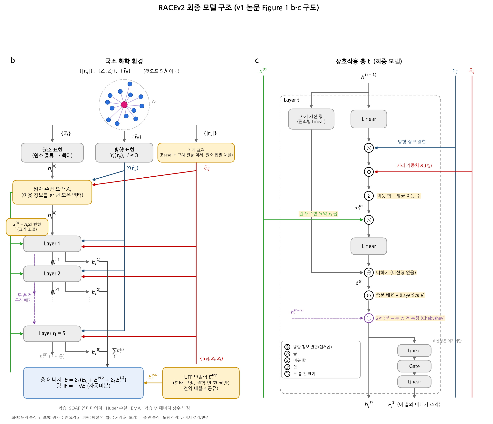

# RACEv2: Highly locally resolved MLIP

RACEv2는 E(3) 등변 메시지 전달 원자간 퍼텐셜 RACE의 개선판이다. 코드는 `bam_omat24` 패키지(JAX + Flax NNX)에 있다.
대칭 연산(irreps, 구면조화함수)은 e3nn-jax로 하고, 가장 무거운 간선 텐서곱은 NVIDIA cuequivariance-jax의 CUDA 커널로 계산한다(`"tp_backend": "cue"`).
설정 파일 이름의 `_cue`는 이 커널을 쓴다는 뜻이다. PyTorch 패키지가 아니다.

모든 결과는 각 데이터셋의 공식 학습셋만으로 학습했다. 사전학습, 추가 데이터, 데이터 증강은 쓰지 않았다.
수식·표·그림 전체는 [`docs/RACEv2_methods_summary.pdf`](docs/RACEv2_methods_summary.pdf)에 있다.



## V1 대비 바뀐 점 (최종 레시피)

| 항목 | RACE V1 | RACEv2 |
|---|---|---|
| 원자 특징 x | 원소 임베딩 (`x_mode=species`) | 이웃 요약에서 층마다 선형 사영 (`x_mode=basis`) |
| x 크기 조절 | 없음 | hill: x/r · 2σ(a log r + b), a·b는 층×원소별 학습값 (`x_norm=hill`) |
| 층 갱신 | 단순 잔차 | Chebyshev식 h⁽ᵗ⁾ = 2γ⊙δ⁽ᵗ⁾ − h⁽ᵗ⁻²⁾, LayerScale 0.5 (`residual=chebyshev`) |
| 메시지 정규화 | LayerNorm + 1/√⟨N⟩ | 평균 이웃 수로 나눔 (`message_norm=avg`) |
| 갱신 / readout | gate / linear | linear / gated |
| 거리 함수 | Bessel | Bessel + 원소 껍질 반지름 채널, Gaussian 고차 진동 억제 prior (σ=0.224) |
| 반발 항 | 없음 | UFF 비결합 반발(형태 고정, 결합 쌍은 부드럽게 끔), 전역 배율 s 학습 |
| 학습 | Adam | SOAP (lr 1e-2, β 0.95), Huber δ=10, EMA 0.99, float64, 학습 후 에너지 상수 보정 δ* |

기본 크기는 5층, lmax 3, 컷오프 5 Å, hidden 128이다. rMD17·MD22는 256, 물은 64를 쓴다.

## 결과 (3시드 평균, 검증 기준 체크포인트)

### 3BPA (RMSE, E meV/분자 / F meV/Å, 300 K 500프레임 학습)

| 모델 | 300 K | 600 K | 1200 K | 이면각 |
|---|---|---|---|---|
| **RACEv2** | **1.56 / 6.31** | **6.05 / 15.92** | **22.20 / 45.16** | 16.67 / 19.09 |
| RACE V1 | 3.4 / 12.1 | 11.7 / 31.8 | 37.5 / 115.3 | — |
| GRACE (PRX 2024) | 1.7 / 7.6 | 7.3 / 19.2 | 25.8 / 61.7 | **7.4 / 15.3** |
| TACE | 2.69 / 8.68 | 8.10 / 19.88 | 23.42 / 54.26 | 11.0 / 16.45 |
| MACE | 3.0 / 8.8 | 9.7 / 21.8 | 29.8 / 62.0 | 7.8 / 16.5 |

### rMD17 (MAE, 공식 분할, 학습 1000, L5h256): 발표된 최고 기록과 비교

각 분자에서 발표된 값 중 가장 낮은 에너지 오차와 가장 낮은 힘 오차를 따로 골랐다. 굵은 글씨가 더 좋은 쪽이다.

| 분자 | RACE V1 E | RACEv2 E | 최고 기록 E | RACE V1 F | RACEv2 F | 최고 기록 F |
|---|---|---|---|---|---|---|
| aspirin | 3.3 | **1.19** | 1.55 (GotenNet) | 9.6 | **4.01** | 5.26 (FreeCG) |
| azobenzene | — | **0.36** | 0.5 (ACE(g)/PACE) | — | **1.41** | 2.09 (GotenNet) |
| benzene | — | 0.02 | **0.01** (ACE(g)) | — | 0.22 | **0.1** (ACE(g)) |
| ethanol | 0.8 | 0.21 | 0.2 (ACE(g)) | 3.6 | 1.41 | 1.4 (ACE(g)) |
| malonaldehyde | 1.4 | **0.36** | 0.5 (ACE(g)/PACE) | 7.2 | **2.49** | 3.1 (ACE(g)) |
| naphthalene | 0.9 | **0.12** | 0.17 (GotenNet) | 2.6 | **0.65** | 0.9 (ACE(g)) |
| paracetamol | — | **0.61** | 0.9 (ACE(g)/PACE) | — | **2.72** | 3.64 (FreeCG) |
| salicylic acid | 1.1 | **0.36** | 0.5 (ACE(g)/PACE) | 5.4 | **2.03** | 2.7 (ACE(g)) |
| toluene | 0.6 | **0.13** | 0.19 (GotenNet) | 2.7 | **0.78** | 1.04 (FreeCG) |
| uracil | 0.7 | 0.20 | 0.2 (ACE(g)) | 4.4 | **1.43** | 1.7 (ACE(g)) |

최고 기록 대비 에너지(meV)는 7승 2무 1패, 힘(meV/Å)은 8승 1무 1패다. V1은 V1 논문에 보고된 7개 분자만 있으며, RACEv2가 에너지 64–87%, 힘 58–75% 낮다. 차이가 반올림 자릿수 안이면 무승부로 셌다.
참조 모델들은 학습 1000프레임을 뺀 나머지 약 99k 프레임으로 시험했고, 우리 표는 공식 테스트 1000프레임 값이다. 99k 프레임으로 평가해도 값이 거의 같다.

### 기타 벤치마크

| 벤치마크 | RACEv2 | 참조값 |
|---|---|---|
| AcAc 300 K / 600 K (RMSE E/F) | 0.46/3.06 · 5.32/15.55 | PACE 0.73/4.2 · 3.8/16.9 |
| Si GAP-18 → RSS (RMSE meV/atom, meV/Å) | 15.65 / 106.7 | XPOT-ACE 20.5 / 139 |
| Si GAP-18 → 압축 MD | 4.47 / 69.0 | GAP-18 15.7 / 125 |
| LiPS 19k (MAE meV/atom, meV/Å) | 0.020 / 1.20 | FreeCG 힘 1.2, GemNet-T 1.3 |
| LiPS 학습곡선 2500/1000/100/10 (힘 MAE) | 2.02 / 3.17 / 9.46 / 34.1 | NequIP 4.7, CarNet 5.6, CAMP 21.6 / 76.4 |
| LiPS MD 50 ps × 5 (안정성 / RDF / Li 확산 오차) | 50 ps / 0.044 / 0.43 | NequIP 50 / 0.04 / 0.34, GemNet-T 0.24 |
| 물 분할 1 / 2 (RMSE meV/H₂O, meV/Å, 반발 항 재계산 진행 중) | 3.38/63.6 · 0.64/21.96 | 같은 분할 MACE 64-0 4.5/64.8 · 0.9/23.2 |

### Ablation (3BPA, 500 ep, 3시드 평균)

최종 레시피에서 한 가지씩만 RACE V1 방식으로 되돌렸다. 각 칸은 보정 에너지 RMSE (meV/분자) / 힘 RMSE (meV/Å)이다.

| 변형 | 300 K | 600 K | 1200 K | 이면각 | 1200 K 힘 변화 |
|---|---|---|---|---|---|
| **최종 레시피** | **1.87 / 6.70** | **6.52 / 16.63** | **22.89 / 46.42** | 16.74 / **19.28** | 기준 |
| 원자 특징 V1식 (원소 임베딩) | 2.55 / 9.52 | 9.80 / 22.69 | 29.86 / 61.44 | **15.36** / 19.95 | +32% |
| hill 제거 (순수 RMS) | 2.20 / 7.36 | 7.60 / 19.08 | 26.68 / 56.67 | 21.04 / 20.17 | +22% |
| Chebyshev 잔차 제거 | 1.94 / 6.85 | 6.81 / 17.32 | 27.75 / 52.39 | 17.79 / 20.16 | +13% |
| LayerScale 제거 | 2.27 / 7.24 | 7.19 / 18.27 | 28.15 / 51.77 | 17.74 / 20.30 | +12% |
| 메시지 정규화 V1식 (LayerNorm + 1/√⟨N⟩) | 2.12 / 6.81 | 6.78 / 17.00 | 25.73 / 49.41 | 19.44 / 20.18 | +6% |

하나만 빼도 600 K와 1200 K에서 에너지와 힘이 모두 나빠지고, 차이는 고온일수록 크다. 예외는 원자 특징 V1식의 이면각 에너지(15.36 vs 16.74)인데, 시드 간 편차가 2.8로 커서 뚜렷한 차이는 아니다. LayerScale을 빼면 1200 K 힘의 시드 간 편차도 0.96에서 3.41로 커진다.
남은 변형은 gate 갱신, radial prior 제거, 껍질 채널 제거, UFF 제거, AMSGrad(SOAP 대신)이다.

진행 중인 항목은 나머지 ablation 5개, OAM 데이터(OMat24·MPtrj·sAlex) 부분집합 검증, 물 반발 항 재계산, MD22이다.

## 설치

```bash
git clone https://github.com/myung-group/BAM_V2.git
cd BAM_V2 && git switch racev2
pip install -e ".[jax]"
pip install cuequivariance-jax cuequivariance-ops-jax-cu12   # tp_backend="cue" 사용 시
```

사용한 버전은 Python 3.12, jax 0.12, flax 0.12, optax 0.2.8, e3nn-jax 0.21, cuequivariance(-jax) 0.13, ase 3.29다.

## 실행

```bash
# 학습 (예: 3BPA 최종 레시피)
python -m bam_omat24.train_3bpa input/input_3bpa_omat24_abl3_full_s42_cue.json
# 테스트
pytest tests
# LiPS MD (Fu et al. 2023 프로토콜)와 관측량 분석
python -m bam_omat24.md_run --help
python -m bam_omat24.md_lips_analysis <md_output_dir>
# 문서·그림 재생성 (docs/fonts/ 에 NanumGothic 폰트 필요, 저장소에는 미포함)
python docs/make_methods_pdf.py
```

GPU에서는 `XLA_FLAGS=--xla_gpu_enable_triton_gemm=false`를 꼭 설정한다. float64 GEMM이 잘못 컴파일되는 XLA 버그를 피하기 위해서다.
KISTI HANGANG Slurm 스크립트 예시는 `runs/diag/*.sh`에 있다.

## 주요 파일

| 파일 | 내용 |
|---|---|
| `bam_omat24/race_nnx.py` | RACEv2 모델 (층, hill, Chebyshev 잔차, UFF 반발, cue 텐서곱) |
| `bam_omat24/train_3bpa.py` | 학습·평가·에너지 상수 보정 |
| `bam_omat24/soap_optax.py`, `soap_grouped.py` | SOAP 옵티마이저 |
| `bam_omat24/md_run.py`, `md_lips_analysis.py` | 재시작 가능한 Nosé–Hoover MD, LiPS 관측량 |
| `input/` | 모든 벤치마크·ablation 설정 |
| `docs/` | 방법 요약 PDF, 구조 그림, 데이터 그림과 생성 스크립트 |

## License

MIT License. [LICENSE](LICENSE) 참조.
