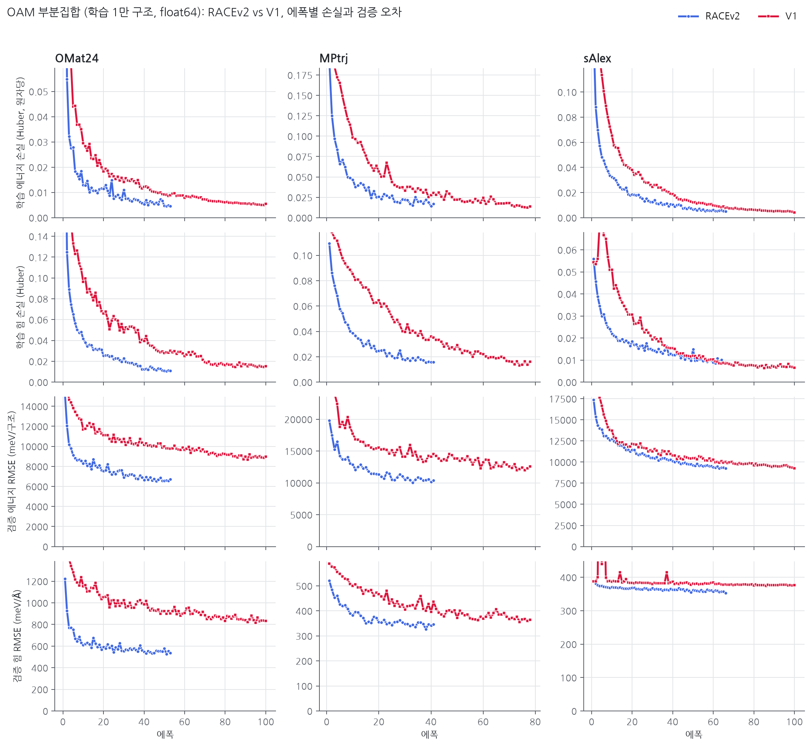

# RACEv2: Highly locally resolved MLIP

RACEv2 is an improved version of RACE, an E(3)-equivariant message-passing interatomic potential. The code lives in the
`bam_omat24` package (JAX + Flax NNX). Symmetry operations (irreps, spherical harmonics) use e3nn-jax; the heaviest
operation, the edge tensor product, runs on the CUDA kernels of NVIDIA cuequivariance-jax (`"tp_backend": "cue"`).
The `_cue` suffix of the config files refers to these kernels; it is not a PyTorch package.

Every result below was trained on the training split of its dataset only: no pretraining, no extra data, no data
augmentation. The UFF repulsion is an external empirical prior (fixed functional form and radii, one learned global
scale); results without it are in the ablation. Water has no official split (two splits are used, see below), and Si
uses 95 % of the GAP-18 training set. Models that use pretraining (MACE-OFF fine-tunes such as MMEA, ELoRA) or
semi-empirical baselines (NN-xTB) are not compared. All equations, tables and figures are collected in
[`docs/RACEv2_methods_summary.pdf`](docs/RACEv2_methods_summary.pdf) (in Korean).


## Changes with respect to RACE V1 (final recipe)

| Component | RACE V1 | RACEv2 |
|---|---|---|
| Atomic feature x | species embedding (`x_mode=species`) | per-layer linear projection of the neighbourhood summary (`x_mode=basis`) |
| Scaling of x | none | hill: x/r · 2σ(a log r + b), a and b learned per layer and element (`x_norm=hill`) |
| Layer update | plain residual | Chebyshev-type h⁽ᵗ⁾ = 2γ⊙δ⁽ᵗ⁾ − h⁽ᵗ⁻²⁾ with LayerScale 0.5 (`residual=chebyshev`) |
| Message normalisation | LayerNorm + 1/√⟨N⟩ | division by the mean neighbour count (`message_norm=avg`) |
| Update / readout | gate / linear | linear / gated |
| Radial basis | Bessel | Bessel + element shell-radius channels, Gaussian prior against high-order oscillations (σ = 0.224) |
| Repulsion | none | UFF non-bonded repulsion (fixed functional form, smoothly switched off for bonded pairs), one learned global scale s |
| Training | Adam | SOAP (lr 1e-2, β 0.95), Huber δ = 10, EMA 0.99, float64, closed-form energy-constant refit δ* after training |

Default size: 5 layers, lmax 3, cutoff 5 Å, 128 channels (256 for rMD17 and MD22, 64 for water).

The locality claim of the title is not tested by the molecular benchmarks below: 3BPA, AcAc and the rMD17 molecules
fit inside the 5 × 5 Å receptive field. MD22 is planned for this purpose.

**Reporting.**
- Checkpoints are selected on validation (EMA weights).
- After training, a single per-atom energy constant δ* is refitted in closed form on the training split only; the
  forces are unchanged. Its effect depends on the dataset:
  - ≤ 0.01 meV/molecule on 3BPA and AcAc at 1500 epochs, and up to 0.007 meV on rMD17;
  - 0.07–0.18 meV/atom on Si;
  - a factor of 5 on the LiPS 19k energy MAE (0.100 → 0.020 meV/atom), and up to 4 meV/molecule in the 500-epoch
    ablation.
  Energy cells show the refitted value; raw values are given where the refit matters.
- ± values and seed spreads are sample standard deviations (ddof = 1) over 3 initialisation seeds on one fixed split;
  split variance is not included.
- Test exposure: the test sets were evaluated during training (every 100 epochs; LiPS every 30–600) and were seen
  during development of the recipe (about 38 screening rounds on 3BPA). Checkpoints were selected on validation only,
  but recipe choices were not (see the 3BPA note).

## Results (mean of 3 seeds, checkpoint selected on validation)

### 3BPA (RMSE, E in meV/molecule / F in meV/Å; train 450 + valid 50 frames at 300 K; test 1669 / 2138 / 2139 / 7047 frames; 3 seeds)

| Model | 300 K | 600 K | 1200 K | Dihedral |
|---|---|---|---|---|
| **RACEv2** (UFF-nb, chosen after test, see note) | 1.56 / **6.31** | **6.05 / 15.92** | 22.20 / **45.16** | 16.67 / 19.09 |
| RACEv2 ZBL-nb (rule fixed in advance) | 1.62 / 6.53 | 7.44 / 16.89 | 24.68 / 50.79 | 10.44 / 17.42 |
| RACE V1 (published, single model) | 3.4 / 12.1 | 11.7 / 31.8 | 37.5 / 115.3 | — |
| GRACE/ACE(g) (PRX 2024, 5 fits) | 1.7 / 7.6 | 7.3 / 19.2 | 25.8 / 61.7 | **7.4 / 15.3** |
| PACE (TMLR 2024, 3 seeds) | 2.4 / 9.1 | 7.9 / 21.4 | 29.6 / 60.7 | 7.6 / 16.0 |
| TACE spe-cart ν=3 (1 seed) | 2.69 / 8.68 | 8.10 / 19.88 | 23.42 / 54.26 | 11.0 / 16.45 |
| SpinGTP | 2.9 / 9.0 | 9.6 / 21.0 | 29.0 / 61.4 | 8.9 / **15.3** |
| ICTP_full (5 runs) | 2.70 / 9.45 | 10.74 / 22.99 | 29.80 / 62.82 | 9.82 / 17.52 |
| MACE | 3.0 / 8.8 | 9.7 / 21.8 | 29.8 / 62.0 | 7.8 / 16.5 |

Notes:
- **Recipe choice.** The UFF-nb repulsion (switch width 0.3 Å) was chosen after inspecting the 600 K, 1200 K and
  dihedral test errors. The rule fixed in advance ("1200 K force ≤ +10 % of the base, lowest dihedral energy")
  selects the ZBL-nb variant, shown as the second row. The expected selection bias is 1–2 seed standard deviations
  (about 0.4–0.8 meV and 0.7–1.4 meV/Å at 1200 K).
- **Energies.** The 300 K energy is within the seed spread of GRACE (not a significant difference). The 1200 K
  energy is below the single-seed TACE value by less than the expected selection bias.
- **Dihedral.** The dihedral scan is a limitation: every listed reference except V1 has lower dihedral errors.
  TACE ν=2 reaches 7.6 meV on the dihedral energy.
- **MAE** (tail-dominated columns), 3-seed mean, E / F: 1200 K 14.19 / 24.62, dihedral 5.94 / 6.28.

### rMD17 (MAE, E meV/molecule / F meV/Å; official split 01: 950 training + 50 validation frames from the 1000-frame training set, 1000 test frames; L5h256) vs the best published values

For every molecule the lowest published energy error and the lowest published force error were picked separately.
Bold marks the better value.

| Molecule | RACE V1 E | RACEv2 E | Best published E | RACE V1 F | RACEv2 F | Best published F |
|---|---|---|---|---|---|---|
| aspirin | 3.3 | **1.19** | 1.55 (GotenNet) | 9.6 | **4.01** | 5.26 (FreeCG) |
| azobenzene | — | **0.36** | 0.5 (ACE(g)/PACE) | — | **1.41** | 2.09 (GotenNet) |
| benzene | — | 0.02 | **0.01** (ACE(g)) | — | 0.22 | **0.1** (ACE(g)) |
| ethanol | 0.8 | 0.21 | 0.2 (ACE(g)) | 3.6 | 1.41 | 1.4 (ACE(g)) |
| malonaldehyde | 1.4 | **0.36** | 0.5 (ACE(g)/PACE) | 7.2 | **2.49** | 3.1 (ACE(g)) |
| naphthalene | 0.9 | **0.12** | 0.17 (GotenNet) | 2.6 | **0.65** | 0.9 (ACE(g)) |
| paracetamol | — | **0.61** | 0.9 (ACE(g)/PACE) | — | **2.72** | 3.64 (FreeCG) |
| salicylic acid | 1.1 | **0.36** | 0.5 (ACE(g)/PACE) | 5.4 | **2.03** | 2.7 (ACE(g)) |
| toluene | 0.6 | **0.13** | 0.19 (GotenNet) | 2.7 | **0.78** | 1.04 (FreeCG) |
| uracil | 0.7 | 0.20 | 0.2 (ACE(g)) | 4.4 | **1.43** | 1.7 (ACE(g)) |

On split 01 (3 seeds), RACEv2 has the lowest error among the listed values for 7 molecules in energy and 8 in
forces. Benzene is worse in both, and ethanol and uracil are equal at the reported precision. Test sets differ:
- PACE (like MACE) uses the official 1000 test frames used here;
- ACE(g) and GotenNet use the remaining ~99k frames;
- FreeCG does not state its test set.

For an earlier model (seed 42; aspirin, ethanol, paracetamol, uracil), the ~99k evaluation agreed closely with
test-1000. The final models have not been evaluated on the ~99k frames yet. RACE V1 reported 7 molecules; on those,
RACEv2 is 64–87 % lower in energy and 58–75 % lower in forces.

### Other benchmarks

| Benchmark | RACEv2 | Reference |
|---|---|---|
| AcAc 300 K / 600 K (RMSE, E meV/molecule / F meV/Å, test 650 / 650) | 0.46/3.06 · 5.32/15.55 | PACE 0.73/4.2 · 3.8/16.9 (TMLR 2024 Tab. 3, 3 seeds, 5000 epochs; the paper labels Tab. 4 as MAE) · ICTP 0.75 (full, 300 K E) · 4.43/22.90 (sym, 600 K) · MACE 0.9/5.1 · 4.6/22.4 |
| Si GAP-18 → RSS (RMSE meV/atom, meV/Å) | 15.65 / 106.7 | XPOT-ACE-3F 20.5 / 139 (du Toit et al. JCTC 2024, single fit) |
| Si GAP-18 → compressed MD | 4.47 / 69.0 | GAP-18 evaluated by us 15.7 / 125 (no published RMSE on this set; not the MQ-MD set of du Toit et al.) |
| LiPS 19k (MAE meV/atom, meV/Å) | 0.020 (raw 0.100) / 1.20 | tie with FreeCG force 1.2; GemNet-T 1.3 |
| LiPS learning curve 2500/1000/100/10 (force MAE) | 2.02 / 3.17 / 9.46 / 34.1 | NequIP 4.7, CarNet 5.6, CAMP 21.6 / 76.4 |
| LiPS MD 50 ps × 5 (stability / RDF / Li diffusivity error) | 50 ps / 0.044 / 0.43 | NequIP 50 / 0.04 / 0.34, GemNet-T 50 / 0.04 / 0.24, E2GNN D error 0.21 (direct forces); Fu et al. Table 6 |
| Water split 1 / 2 (RMSE, E meV/H₂O / F meV/Å; 3 seeds; split 2 test = last 200 frames, all PIMD) | 3.38/63.6 · 0.57/21.84 | MACE 64-0 retrained on the same splits (stage 2, 1 seed): 4.5/64.8 · 0.75–1.05/23.2 (split-2 energy from logs rounded to 0.1 meV/atom; not decidable) |

Notes on this table:
- **AcAc:** the 600 K energy is worse than PACE, ICTP and MACE. Its RMSE is dominated by a few frames (MAE 1.69).
  The AcAc dihedral and H-transfer sets are not reported yet.
- **Si:** only ACE/GAP baselines exist on these test sets; no MPNN has been evaluated with this protocol.
- **LiPS MD:** our Li diffusivity error is higher than NequIP, GemNet-T and E2GNN (0.43 vs 0.21–0.34 ×10⁻⁹ m²/s).
- **Water:** the differences to MACE are within the bootstrap confidence interval on split 1 (one test frame carries
  about 70 % of the force error). The split-2 energies cannot be compared because the MACE logs are rounded.

### Ablation (3BPA, 500 epochs, mean of 3 seeds)

One component at a time is reverted to RACE V1. Each cell: refitted energy RMSE (meV/molecule) / force RMSE (meV/Å).

| Variant | 300 K | 600 K | 1200 K | Dihedral | 1200 K force change |
|---|---|---|---|---|---|
| Final recipe | 1.87 / 6.70 | 6.52 / 16.63 | **22.89 / 46.42** | 16.74 / 19.28 | reference |
| V1 atomic feature (species embedding) | 2.55 / 9.52 | 9.80 / 22.69 | 29.86 / 61.44 | 15.36 / 19.95 | +32 % |
| No Gaussian radial prior | 2.05 / 7.22 | 7.34 / 18.93 | 28.22 / 60.12 | 28.06 / 23.32 | +30 % |
| No hill (plain RMS) | 2.20 / 7.36 | 7.60 / 19.08 | 26.68 / 56.67 | 21.04 / 20.17 | +22 % |
| No Chebyshev residual | 1.94 / 6.85 | 6.81 / 17.32 | 27.75 / 52.39 | 17.79 / 20.16 | +13 % |
| No LayerScale | 2.27 / 7.24 | 7.19 / 18.27 | 28.15 / 51.77 | 17.74 / 20.30 | +12 % |
| V1 message normalisation (LayerNorm + 1/√⟨N⟩) | 2.12 / 6.81 | 6.78 / 17.00 | 25.73 / 49.41 | 19.44 / 20.18 | +6 % |
| V1 update (gate) | **1.80 / 6.39** | **6.41 / 16.26** | 24.15 / 46.91 | **15.07 / 18.60** | +1 % |

Bold marks the lowest value per column. Apart from the gate update, reverting any single component worsens both
energies and forces at 600 K and 1200 K, and the absolute gap grows with temperature. The V1 atomic feature improves
only the dihedral energy (15.36 vs 16.74), within the seed spread (sample std over 3 seeds: 3.5). Removing LayerScale
also raises the seed spread (sample std) of the 1200 K force error from 1.17 to 4.18.

At 500 epochs the energy constant is not converged: the refit lowers the 300 K energy RMSE of the final recipe from
3.34 to 1.87 meV, and that of the variants by 0.1–4.2 meV. Without the refit, three variants have a lower 300 K
energy than the final recipe. The 600 K and 1200 K orderings are the same with raw energies.
Reverting to the gate update is equal or better except for the 1200 K energy (+6 %); the linear update shows no gain
in this setting. Removing the Gaussian radial prior gives the worst dihedral scan (28.06 vs 16.74 meV, +68 %) and
the second-largest 1200 K force increase. Remaining variants: no shell channels, no UFF, AMSGrad instead of SOAP.

### OAM subset comparison (RACEv2 vs V1, 2026-11-06)

Before training a universal model (OMat24 pretraining, MPtrj + sAlex fine-tuning), RACEv2 and V1 were compared on
random subsets of each dataset: 10k training, 1k validation, 1k test structures. Both recipes: float64, 100 epochs,
packed batches of about 16 structures, stress in the loss (weight 10), per-element reference energies from a least-
squares fit to the full training split of each dataset. V1 reverts every RACEv2 addition (including AMSGrad).
One seed.



Test set (1,000 structures, checkpoint selected on validation):

| Data | Recipe | Energy MAE (meV/atom) | Force RMSE / MAE (meV/Å) | Stress MAE (GPa, per component) | Training time per epoch |
|---|---|---|---|---|---|
| OMat24 | **RACEv2** | **110** | **490 / 256** | **1.62** | 89 s |
| OMat24 | V1 | 160 | 751 / 353 | 2.02 | 41 s |
| MPtrj | **RACEv2** | **103** | **560 / 142** | **0.96** | 114 s |
| MPtrj | V1 | 131 | 847 / 169 | 1.12 | 59 s |
| sAlex | **RACEv2** | **166** | **306 / 104** | **1.13** | 71 s |
| sAlex | V1 | 178 | 344 / 120 | 1.34 | 30 s |

In this single-seed comparison, which mixes the architecture and the optimizer (V1 also uses AMSGrad), RACEv2 is better
on every metric of all three datasets: energy MAE 7–31 % lower, force RMSE 11–35 % lower, stress
MAE 14–20 % lower. It is 2–2.4× slower per epoch: refreshing the SOAP eigenbases takes 40–60 % of a step
(`runs/diag/soap_profile.py`).
The per-atom energy errors (100–180 meV) are large for both recipes. With 89 elements and 10k structures, the
element-specific weights (89 % of the RACEv2 parameters) see little data.

Notes from the screening:
- SOAP diverges in float32 on these data within 30–80 steps, independently of learning rate, implementation and TF32;
  in float64 (or with a float64 optimizer state) it is stable, so this comparison used float64.
- Stress-loss weight: 10, 100 and 1000 (30 epochs) give nearly the same stress error, while 100 and 1000 make energies
  and forces worse. Stress is learned through the energy and forces; its error is not limited by the loss weight.
  Weight 10 was kept (chosen on validation).
- Speed-ups of the SOAP optimizer and the cutoff (30 epochs, validation; energy MAE meV/atom / force RMSE meV/Å,
  time per epoch):

  | Variant | OMat24 | MPtrj | sAlex |
  |---|---|---|---|
  | RACEv2 (SOAP on every tensor, refresh every 10 steps) | 127 / 528, 93 s | 152 / 337, 118 s | 186 / 365, 76 s |
  | refresh every 50 steps | 135 / 566, 67 s | 156 / 348, 91 s | 202 / 368, 53 s |
  | **species tables by Adam** | 135 / 522, 75 s | 150 / 341, 99 s | 188 / 365, 59 s |
  | both | 146 / 551, 64 s | 152 / 352, 88 s | 179 / 364, 46 s |
  | cutoff 6 Å | 135 / 561, 104 s | 148 / 350, 138 s | 196 / 365, 85 s |

  Adam for the species-indexed tables keeps the force error of full SOAP and is 16–22 % faster; it is used from
  here on. A 6 Å cutoff is not better on these subsets and is 12–17 % slower; 5 Å is kept.

#### Model size on 100k OMat24 structures (in progress)

100k training / 2k validation / 1k test structures, float64, species tables by Adam, 30 epochs. Candidates: L5×64,
L5×128, L5×192, L4×128, L6×128 (layers × channels), plus L5×128 with AMSGrad as an optimizer control. The selection
rule was fixed before the runs (`docs/size_screening_protocol_2026-11-03.md`, validation only): candidates within
+10 % of the best validation energy RMSE, then the lowest validation force RMSE, ties (< 2 %) to the smaller model.
Time per epoch on one GH200: 834 s (L4×128), 1010 s (L5×128), 1196 s (L6×128), 1419 s (L5×192).

### RACE_LR: charge equilibration and long-range electrostatics (preliminary, 2026-11-06)

`"model": "RACE_LR"` adds one non-local stratum to RACEv2 and leaves RACE unchanged.
- **Inputs to the stratum.** Environment-dependent electronegativities χ_i and hardnesses J_i come from the
  scalar features of the last RACE layer.
- **Charges.** A charge equilibration step gives the charges q, with the total charge Q of each structure as a
  constraint: Q is read from the extxyz info key `total_charge_key`.
- **Electrostatics.** Gaussian-charge Coulomb uses a direct sum for molecules and an Ewald sum for periodic cells.
- **Training.** It uses energies, forces and stress only. The charges are latent and get no charge labels.
- Design and limits: `docs/RACE_LR_design.md`.

**Benchmark.** The four systems of the 4G-HDNNP paper (Ko et al., Nat. Commun. 12, 398 (2021); Materials Cloud
2020.137, CC BY 4.0), converted with `data_prep/convert_4ghdnnp.py` (`docs/DATASETS.md` §16).

**Local small-budget test** (not the final result).
- Model: the 3BPA recipe at reduced size (hidden 64, 3 layers, lmax 2, float64). Both models use the same settings.
- Training set: 1000 structures, balanced by charge state. For Au2/MgO it is 100 structures.
- Schedule: 200 epochs, and 20 for Au2/MgO. One seed, one RTX 4060 Ti.
- Test set: the full test split (10 % of each system).
- Energy correction: the energies are given after a per-composition energy-constant refit on the training split.
  The trainer's single per-atom refit cannot remove the offset between two compositions, which otherwise dominates
  the carbon-chain and NaCl numbers.
- Details: `docs/local_test_report.md` §7–8.

| System (test frames) | What a local model cannot see | E RMSE (meV), RACE_LR / RACE | F RMSE (meV/Å), RACE_LR / RACE |
|---|---|---|---|
| Ag3+ / Ag3− (1101) | total charge, same geometry | **28.8** / 1169 | **13.9** / 4152 |
| C10H2 / C10H3+ (1002) | protonation at the far end of the chain | **2.7** / 3.7 | **15.1** / 20.2 |
| Na9Cl8+ / Na8Cl8+ (500) | charge redistribution after removing one Na | 26.8 / 27.1 | 42.4 / 43.3 |
| Au2 on MgO(001), doped / undoped (500) | dopant 10 Å below the Au2 | pipeline check only (100 training structures, 20 epochs) | |

- **Ag3.** RACE cannot separate the two charge states where their geometries overlap: single Ag3− frames reach an
  energy error of 7 eV, and its training was unstable after epoch 45.
- **Carbon chain.** The gain is about 25 % in energy and force.
- **NaCl.** There is no difference at this budget.

**Does it capture the long-range physics?**

Lower errors alone do not show it: knowing the total charge would already fix most of Ag3. Two checks use the
DFT Hirshfeld charges, which are never used in training:

| System | Correlation of q with Hirshfeld | Mean abs(q), model / DFT |
|---|---|---|
| Ag3− | 0.91 | 0.333 / 0.333 |
| C10H2 | 0.85 | 0.004 / 0.035 |
| C10H3+ | −0.63 | 0.077 / 0.077 |
| NaCl (both states) | 0.96–0.99 | 0.06 / 0.36–0.41 |

1. **Non-local charge transfer.** Protonation of one end of the carbon chain changes the charge of the carbon at
   the other end, 11.4 Å away and well outside the 5 Å cutoff, by +0.115 e. DFT gives +0.132 e. A purely local
   model cannot see the protonation from that atom. RACE_LR captures this transfer.
2. **Charge pattern.** The model spreads the extra charge almost uniformly over the chain and misses the
   alternation of the DFT charges (+0.13, +0.05, +0.10, +0.05, ...).
3. **Magnitude.** On NaCl the signs are right, but the charges are about six times too small, so most of the ionic
   energy is still carried by the short-range strata.

So, at this budget, RACE_LR captures the global charge state and the long-range redistribution, but not
quantitative atomic charges. Next checks:
- the Au2/MgO doping effect, trained on the HPC;
- the 1/r tail when charged fragments are pulled apart beyond the cutoff;
- the error at reduced cutoff, compared with RACE;
- the hardness and electronegativity initialisation, or an optional Hirshfeld charge loss as in 4G-HDNNP.

Work in progress: 100k size comparison, ablations without shell channels / UFF / SOAP (AMSGrad), last-layer Bayesian
uncertainty, water rerun with repulsion, MD22.

## LAMMPS (`pair_style race`, experimental)

The trained model is exported to StableHLO (`bam_omat24/export_lammps.py`) and run from C++ through the PJRT CUDA
plugin that ships with jaxlib (`lammps/`). Neither Python nor JAX is needed at run time. The cuEquivariance kernels
are recompiled in the C++ process from a record written at export and registered with the plugin (FFI).

```
pair_style race <site-packages>/jax_plugins/xla_cuda12/xla_cuda_plugin.so <export dir> [gpu auto|<index>] [mode auto|owner|halo|ghost]
pair_coeff * * Li P S
```

- `mode owner` (one MPI rank): graph of the owned atoms, ghost neighbours mapped to their owned images. Fastest on
  one GPU.
- `mode halo` (any number of ranks, GPUs and nodes): per-layer halo exchange, as in other message-passing potentials
  with spatial decomposition (e.g. SevenNet). The export contains one function per layer and its vector-Jacobian
  product (`--staged-buckets`). Each rank holds its owned atoms plus one ghost shell (cutoff + skin), with edges for
  owned centres only. The node features are sent to the ghosts with LAMMPS forward communication after every layer.
  In the backward pass, the ghost-row cotangents are returned to their owners with reverse communication (including
  the Chebyshev term that reads layer i−2). Memory per rank scales with the owned atoms.
- `mode ghost`: single evaluation on owned + ghost atoms with the ghost cutoff raised to n_layers × cutoff + skin.
  Simple, but memory grows with the (5 × 5 Å) ghost shell; out of memory above ~1k atoms per rank.
- `mode auto`: owner for one rank, halo for several ranks when the export has the staged functions (ghost otherwise);
  `gpu auto` uses the node-local rank. Units: metal and real.

Validation (LiPS model, cue kernels, float64):

| Test | Result |
|---|---|
| owner, 83 atoms, vs Python | energy 2×10⁻¹³ eV, forces 9×10⁻¹⁴ eV/Å, pressure 10⁻³ bar; NVE drift 0.001 meV/atom per ps |
| owner speed, 1 GH200 | 83 atoms: 7.3 ms per force call; 664 atoms: 30 steps/s; 5,312 atoms: 4.1 steps/s |
| halo on 1, 2, 4 ranks vs owner (664 and 5,312 atoms) | \|ΔE\| ≤ 1×10⁻⁹ eV, max \|ΔF\| 1×10⁻¹⁴ eV/Å, \|ΔP\| ≤ 4×10⁻¹⁰ bar; NVE conserved |

Weak scaling of `mode halo` (5,312 atoms per GPU, replicated LiPS frame; energy per cell and forces of equivalent
atoms agree with the 1-GPU run within 4×10⁻¹² eV and 2×10⁻¹² eV/Å):

| GPUs (nodes) | Atoms | Steps/s | 10³ atom-steps/s | Efficiency vs 1 GPU |
|---|---|---|---|---|
| 1 (1) | 5,312 | 1.24 | 6.6 | 100 % |
| 2 (1) | 10,624 | 0.87 | 9.2 | 70 % |
| 4 (1) | 21,248 | 1.13 | 24.0 | 91 % |
| 8 (2) | 42,496 | 1.09 | 46.3 | 88 % |

On one GPU halo is 3.3× slower than owner (4.1 steps/s). Three costs cause this: the vector-Jacobian products
recompute each layer, the ghost shell doubles the nodes, and there are 12 sequential executions per step. Halo is
for systems that do not fit on one GPU. The 2-GPU point is low because of slower host↔device copies with two ranks;
not yet understood.
Build: `bash lammps/build_lammps.sh <LAMMPS source> <build dir> [mpi|serial]`. Tests: `runs/diag/lammps_multi.py`,
`runs/diag/lammps_weak.py`, `runs/diag/staged_check.py`.

## Installation

```bash
git clone https://github.com/myung-group/BAM_V2.git
cd BAM_V2 && git switch racev2
pip install -e ".[jax]"
pip install cuequivariance-jax cuequivariance-ops-jax-cu12   # for tp_backend="cue"
```

Tested with Python 3.12, jax 0.12, flax 0.12, optax 0.2.8, e3nn-jax 0.21, cuequivariance(-jax) 0.13, ase 3.29.

## Usage

```bash
# training (e.g. the 3BPA final recipe)
python -m bam_omat24.train_3bpa input/input_3bpa_omat24_abl3_full_s42_cue.json
# tests
pytest tests
# LiPS MD (Fu et al. 2023 protocol) and observables
python -m bam_omat24.md_run --help
python -m bam_omat24.md_lips_analysis <md_output_dir>
# regenerate the methods PDF and figures (needs NanumGothic fonts in docs/fonts/, not in the repository)
python docs/make_methods_pdf.py
```

On GPUs always set `XLA_FLAGS=--xla_gpu_enable_triton_gemm=false`; it avoids an XLA miscompilation of float64 GEMMs.
Example Slurm scripts for KISTI HANGANG are in `runs/diag/*.sh`.

## Main files

| File | Content |
|---|---|
| `bam_omat24/race_nnx.py` | RACEv2 model (layers, hill, Chebyshev residual, UFF repulsion, cue tensor product) |
| `bam_omat24/train_3bpa.py` | training, evaluation, energy-constant refit |
| `bam_omat24/long_range.py`, `race_lr_nnx.py` | RACE_LR: Gaussian-charge Coulomb / Ewald, charge equilibration, RACE subclass |
| `bam_omat24/soap_optax.py`, `soap_grouped.py` | SOAP optimizer |
| `bam_omat24/md_run.py`, `md_lips_analysis.py` | restartable Nosé–Hoover MD, LiPS observables |
| `bam_omat24/export_lammps.py`, `lammps/` | StableHLO export, PJRT C++ runtime, `pair_style race` |
| `input/` | configs of all benchmarks and ablations |
| `docs/` | methods PDF, architecture and data figures with their scripts |

## License

MIT License, see [LICENSE](LICENSE).
