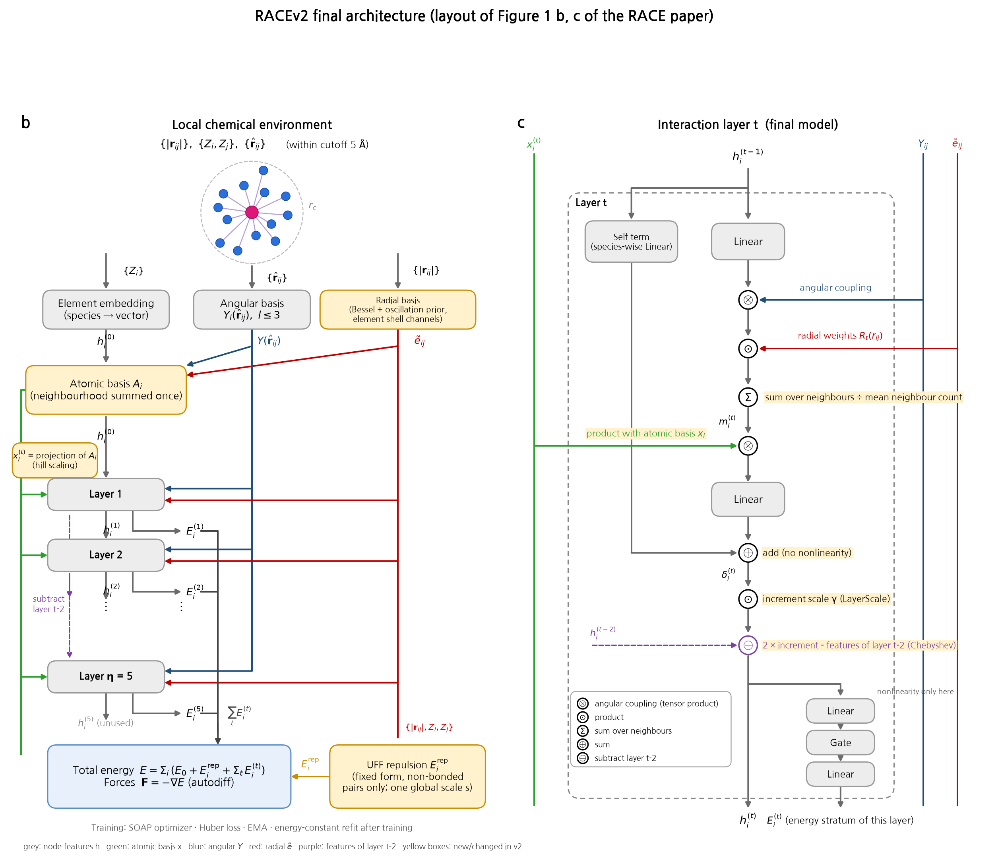

<p align="center"></p>

# RACE v2

> **Branch notice (2026-11-16).** `main` now holds the RACE v2 code in a new layout (python package `race_v2`).
> The previous `main` (BAM_V2 up to April 2026, with `bam_torch`, `bam_torch_cue` and `bam_3bpa`) was moved to the
> [`deprecated`](https://github.com/myung-group/BAM_V2/tree/deprecated) branch. Use that branch if you depend on the
> old code.

RACE v2 is an E(3)-equivariant message-passing interatomic potential, an improved version of RACE. The code is written
in JAX (Flax NNX); symmetry operations use e3nn-jax, and the edge tensor product runs on the CUDA kernels of NVIDIA
cuEquivariance. This repository (distribution name `BAM_V2`) holds the model, the training, inference, evaluation and
export code, and the results obtained with it.



## Repository layout

| Folder | Content |
|---|---|
| `race_v2/` | the package: `models`, `data`, `training`, `inference`, `eval`, `export` |
| `race_v2_torch/` | PyTorch inference port (no JAX needed), see its [README](race_v2_torch/README.md) |
| `scripts/` | launchers and helpers: `train`, `eval` (Matbench Discovery, uncertainty, benchmarks), `data` |
| `configs/` | representative configs, see [configs/README.md](configs/README.md) |
| `docs/` | documentation; results per model under `docs/results/` |
| `lammps/` | `pair_style race` |
| `research/` | diagnostics, one-off launchers and old configs |
| `tests/` | unit tests |
| `bam_omat24/`, `racev2_torch/` | generated aliases, so that the old package names and commands keep working |

Old and new names, commands and the limits of the aliases: [docs/LAYOUT.md](docs/LAYOUT.md).

## Results

### Universal models

| Model | Benchmark | Result | Details |
|---|---|---|---|
| **RACE v2 OAM** (17.8M parameters; OMat24 2 epochs, then MPtrj ×8 + sAlex ×1) | Matbench Discovery, full WBM, unique prototypes | F1 0.893, MAE 0.0214 eV/atom, R² 0.872, RMSD 0.0643 Å, κ SRME 0.229, CPS 0.858 (about rank 20 of 49 on the leaderboard read on 2026-11-15) | [docs/results/race_v2_oam_mbd](docs/results/race_v2_oam_mbd/README.md) |
| **RACE v2 MPtrj-only** (17.8M) | same | F1 0.777, MAE 0.040, R² 0.800, RMSD 0.0785, κ SRME 0.375, CPS 0.761 (about rank 6 of the 19 MPtrj-only models) | same folder |
| **RACE v2 LR-POLAR** (OMol25 4M) | OMol25 validation sets | see the folder | [docs/results/race_v2_lr_polar_omol25_4m](docs/results/race_v2_lr_polar_omol25_4m/README.md) |

The Matbench Discovery numbers use float64 inference of the float32-trained model (`BAM_PREDICT_X64=1`,
[docs/inference_precision.md](docs/inference_precision.md)), no energy corrections, and the last epoch of a schedule
fixed before the evaluation.

### Small-data benchmarks

Protocol of this section:
- Each model is trained on the training split of its dataset only: no pretraining, no extra data, no augmentation.
- Values are means of 3 seeds. Checkpoints are selected on validation (EMA weights).
- Energies are given after a closed-form refit of one per-atom energy constant on the training split; forces are
  unchanged.
- The test sets were evaluated during training and were seen while the recipe was developed. The 3BPA note below
  states where a choice was made after looking at test errors.

**3BPA** (RMSE, E in meV/molecule / F in meV/Å; trained on 450 frames at 300 K)

| Model | 300 K | 600 K | 1200 K | Dihedral |
|---|---|---|---|---|
| **RACE v2** (UFF-nb, chosen after test, see note) | 1.56 / **6.31** | **6.05 / 15.92** | 22.20 / **45.16** | 16.67 / 19.09 |
| RACE v2 ZBL-nb (rule fixed in advance) | 1.62 / 6.53 | 7.44 / 16.89 | 24.68 / 50.79 | 10.44 / 17.42 |
| RACE V1 (published, single model) | 3.4 / 12.1 | 11.7 / 31.8 | 37.5 / 115.3 | — |
| GRACE/ACE(g) (PRX 2024, 5 fits) | 1.7 / 7.6 | 7.3 / 19.2 | 25.8 / 61.7 | **7.4 / 15.3** |
| PACE (TMLR 2024, 3 seeds) | 2.4 / 9.1 | 7.9 / 21.4 | 29.6 / 60.7 | 7.6 / 16.0 |
| TACE spe-cart ν=3 (1 seed) | 2.69 / 8.68 | 8.10 / 19.88 | 23.42 / 54.26 | 11.0 / 16.45 |
| SpinGTP | 2.9 / 9.0 | 9.6 / 21.0 | 29.0 / 61.4 | 8.9 / **15.3** |
| ICTP_full (5 runs) | 2.70 / 9.45 | 10.74 / 22.99 | 29.80 / 62.82 | 9.82 / 17.52 |
| MACE | 3.0 / 8.8 | 9.7 / 21.8 | 29.8 / 62.0 | 7.8 / 16.5 |

- **Recipe choice.** The UFF-nb repulsion was chosen after inspecting the 600 K, 1200 K and dihedral test errors. The
  rule fixed in advance selects the ZBL-nb variant (second row). The expected selection bias is 1–2 seed standard
  deviations (about 0.4–0.8 meV and 0.7–1.4 meV/Å at 1200 K).
- **Dihedral scan.** This is a limitation: every listed reference except V1 has lower dihedral errors.

**rMD17** (MAE, E in meV/molecule / F in meV/Å; split 01, 950 training frames, 1000 test frames; 256 channels)

For every molecule the lowest published energy error and the lowest published force error were picked separately.

| Molecule | RACE V1 E | RACE v2 E | Best published E | RACE V1 F | RACE v2 F | Best published F |
|---|---|---|---|---|---|---|
| aspirin | 3.3 | **1.19** | 1.55 (GotenNet) | 9.6 | **4.01** | 5.26 (FreeCG) |
| azobenzene | — | **0.36** | 0.5 (ACE(g)/PACE) | — | **1.41** | 2.09 (GotenNet) |
| benzene | — | 0.02 | **0.01** (ACE(g)) | — | 0.22 | **0.1** (ACE(g)) |
| ethanol | 0.8 | 0.21 | 0.2 (ACE(g)) | 3.6 | 1.41 | 1.4 (ACE(g)) |
| malonaldehyde | 1.4 | **0.36** | 0.5 (ACE(g)/PACE) | 7.2 | **2.49** | 3.1 (ACE(g)) |
| naphthalene | 0.9 | **0.12** | 0.17 (GotenNet) | 2.6 | **0.65** | 0.9 (ACE(g)) |
| paracetamol | — | **0.61** | 0.9 (ACE(g)/PACE) | — | **2.72** | 3.64 (FreeCG) |
| salicylic acid | 1.1 | **0.36** | 0.5 (ACE(g)/PACE) | 5.4 | **2.03** | 2.7 (ACE(g)) |
| toluene | 0.6 | **0.13** | 0.19 (GotenNet) | 2.7 | **0.78** | 1.04 (FreeCG) |
| uracil | 0.7 | 0.20 | 0.2 (ACE(g)) | 4.4 | **1.43** | 1.7 (ACE(g)) |

The test sets differ between papers: PACE and MACE use the 1000 test frames used here, ACE(g) and GotenNet the
remaining ~99k frames, and FreeCG does not state its test set.

**Other benchmarks**

| Benchmark | RACE v2 | Reference |
|---|---|---|
| AcAc 300 K / 600 K (RMSE, E meV/molecule / F meV/Å) | 0.46/3.06 · 5.32/15.55 | PACE 0.73/4.2 · 3.8/16.9; MACE 0.9/5.1 · 4.6/22.4 |
| Si GAP-18 → RSS (RMSE meV/atom, meV/Å) | 15.65 / 106.7 | XPOT-ACE-3F 20.5 / 139 |
| Si GAP-18 → compressed MD | 4.47 / 69.0 | GAP-18 evaluated by us 15.7 / 125 |
| LiPS 19k (MAE meV/atom, meV/Å) | 0.020 / 1.20 | FreeCG force 1.2; GemNet-T 1.3 |
| LiPS learning curve 2500/1000/100/10 (force MAE) | 2.02 / 3.17 / 9.46 / 34.1 | NequIP 4.7, CarNet 5.6, CAMP 21.6 / 76.4 |
| LiPS MD 50 ps × 5 (stability / RDF / Li diffusivity error) | 50 ps / 0.044 / 0.43 | NequIP 50 / 0.04 / 0.34, GemNet-T 50 / 0.04 / 0.24 |
| Water split 1 / 2 (RMSE, E meV/H₂O / F meV/Å) | 3.38/63.6 · 0.57/21.84 | MACE 64-0 retrained on the same splits: 4.5/64.8 · 0.75–1.05/23.2 |

Where RACE v2 is not ahead: the AcAc 600 K energy is worse than PACE and MACE, the LiPS Li diffusivity error is higher
than NequIP and GemNet-T, and the water differences to MACE are within the bootstrap confidence interval.

### Ablation (3BPA, 500 epochs, mean of 3 seeds)

One component at a time is reverted to RACE V1. Each cell: energy RMSE (meV/molecule) / force RMSE (meV/Å).

| Variant | 300 K | 600 K | 1200 K | Dihedral | 1200 K force change |
|---|---|---|---|---|---|
| Final recipe | 1.87 / 6.70 | 6.52 / 16.63 | **22.89 / 46.42** | 16.74 / 19.28 | reference |
| V1 atomic feature (species embedding) | 2.55 / 9.52 | 9.80 / 22.69 | 29.86 / 61.44 | 15.36 / 19.95 | +32 % |
| No Gaussian radial prior | 2.05 / 7.22 | 7.34 / 18.93 | 28.22 / 60.12 | 28.06 / 23.32 | +30 % |
| No hill (plain RMS) | 2.20 / 7.36 | 7.60 / 19.08 | 26.68 / 56.67 | 21.04 / 20.17 | +22 % |
| No Chebyshev residual | 1.94 / 6.85 | 6.81 / 17.32 | 27.75 / 52.39 | 17.79 / 20.16 | +13 % |
| No LayerScale | 2.27 / 7.24 | 7.19 / 18.27 | 28.15 / 51.77 | 17.74 / 20.30 | +12 % |
| V1 message normalisation (LayerNorm + 1/√⟨N⟩) | 2.12 / 6.81 | 6.78 / 17.00 | 25.73 / 49.41 | 19.44 / 20.18 | +6 % |
| V1 update (gate) | **1.80 / 6.39** | **6.41 / 16.26** | 24.15 / 46.91 | **15.07 / 18.60** | +1 % |

Apart from the gate update, reverting any single component worsens energies and forces at 600 K and 1200 K. The gate
update is equal or better except for the 1200 K energy, so the linear update shows no gain in this setting.

## Changes with respect to RACE V1

| Component | RACE V1 | RACE v2 |
|---|---|---|
| Atomic feature x | species embedding | per-layer linear projection of the neighbourhood summary |
| Scaling of x | none | hill: x/r · 2σ(a log r + b), a and b learned per layer and element |
| Layer update | plain residual | Chebyshev-type h⁽ᵗ⁾ = 2γ⊙δ⁽ᵗ⁾ − h⁽ᵗ⁻²⁾ with LayerScale 0.5 |
| Message normalisation | LayerNorm + 1/√⟨N⟩ | division by the mean neighbour count |
| Update / readout | gate / linear | linear / gated |
| Radial basis | Bessel | Bessel + element shell-radius channels, Gaussian prior against high-order oscillations |
| Repulsion | none | UFF non-bonded repulsion with one learned global scale |
| Training | Adam | SOAP, Huber loss, EMA |

Default size: 5 layers, lmax 3, 128 channels. The cutoff is 5 Å for the small-data benchmarks and 7 Å for the
Matbench Discovery models. Equations, tables and figures: [docs/RACEv2_methods_summary.pdf](docs/RACEv2_methods_summary.pdf)
(small-data recipe, in Korean) and the report in [docs/results/race_v2_oam_mbd](docs/results/race_v2_oam_mbd/README.md)
(Matbench Discovery models, in Korean).

## Other components

- **Long-range models** (`"model": "RACE_LR"`, `"RACE_POLAR"`): charge equilibration with Gaussian-charge Coulomb
  (direct sum or Ewald) on top of RACE v2. Design: [docs/RACE_LR_design.md](docs/RACE_LR_design.md). Tests:
  [docs/RACE_LR_results_summary_ko_2026-11-11.pdf](docs/RACE_LR_results_summary_ko_2026-11-11.pdf) (in Korean).
- **Streaming loader** (`"data_format": "stream"`): trains from ASE databases without graphs on disk, with size tables
  made in advance; several datasets can be mixed with repeats. Design: [docs/stream_loader_design.md](docs/stream_loader_design.md).
  Prepared size tables and reference energies: [scripts/data/prep_results](scripts/data/prep_results/README.md).
- **Uncertainty**: last-layer Bayesian regression and a Laplace approximation in the SOAP eigenbasis
  (`race_v2/eval`, `scripts/eval/uq`). In the Matbench Discovery study the force uncertainty separates molecular and
  surface data from the training distribution (AUROC 0.96) but does not identify the WBM structures with large
  errors.
- **LAMMPS** (`pair_style race`, experimental): the model is exported to StableHLO and run from C++ without Python.
  One GPU (`mode owner`) or several ranks with per-layer halo exchange (`mode halo`). Build:
  `bash lammps/build_lammps.sh <LAMMPS source> <build dir> [mpi|serial]`.
- **PyTorch port** (`race_v2_torch`): converts a JAX checkpoint and runs inference in float64 without JAX.

The earlier, longer README with every benchmark note, the OAM subset and model-size screening, the RACE_LR local tests
and the LAMMPS validation tables is kept in [docs/README_full_2026-11-16.md](docs/README_full_2026-11-16.md).

## Installation

```bash
git clone https://github.com/myung-group/BAM_V2.git
cd BAM_V2
pip install -e ".[jax]"
pip install cuequivariance-jax cuequivariance-ops-jax-cu12   # for "tp_backend": "cue"
```

Tested with Python 3.12, jax 0.12, flax 0.12, optax 0.2.8, e3nn-jax 0.21, cuequivariance(-jax) 0.13, ase 3.29.

## Usage

```bash
# training
python -m race_v2.training.train configs/base/race_v2_base_recipe.json
# prediction (float64 inference of a float32-trained model: BAM_PREDICT_X64=1)
python -m race_v2.inference.predict --help
# molecular dynamics
python -m race_v2.inference.md_run --help
# unit tests
pytest tests
```

- On GPUs always set `XLA_FLAGS=--xla_gpu_enable_triton_gemm=false`; it avoids an XLA miscompilation of float64 GEMMs.
- Matbench Discovery evaluation (WBM relaxation, κ, ranking): `scripts/eval/mbd`, described in
  [docs/results/race_v2_oam_mbd](docs/results/race_v2_oam_mbd/README.md).
- Datasets and their conversion: [docs/DATASETS.md](docs/DATASETS.md).

## License

MIT License, see [LICENSE](LICENSE).
